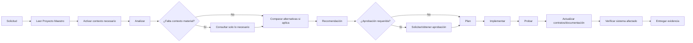

# Flujo de trabajo de la IA

> **Clasificación:** OBLIGATORIO  
> **Estado:** Operativo

## Propósito

Estandarizar el ciclo de trabajo de cualquier agente o asistente.

## 1. Activación de contexto

Antes de analizar:

1. leer `PROYECTO_MAESTRO.md`;
2. identificar perfiles técnicos relevantes;
3. consultar `MATRIZ_ACTIVACION.md`;
4. usar `ENRUTADOR_DOCUMENTACION.md`;
5. cargar solo módulo, flujo, requisito y políticas capaces de cambiar el resultado.

## 2. Modo análisis

Permitido:

- inspeccionar;
- reconstruir comportamiento;
- detectar riesgos;
- comparar opciones;
- estimar impacto;
- preparar ADR/RFC;
- proponer plan.

No ejecutar cambios materiales sin autorización cuando la política la exija.

## 3. Modo decisión

Si existen alternativas:

- aplicar `MARCO_TOMA_DECISIONES.md`;
- incluir opción simple;
- considerar operación y reversibilidad;
- evitar seleccionar por moda;
- registrar decisión aprobada.

## 4. Modo ejecución

1. cambio mínimo coherente;
2. TDD o validación equivalente;
3. contratos;
4. pruebas necesarias;
5. regresión;
6. documentación;
7. trazabilidad;
8. verificación operacional si aplica.

## 5. Modo cierre

Entregar:

- qué cambió;
- decisión/ADR/RFC;
- contratos afectados;
- pruebas;
- documentación;
- riesgos;
- pendientes;
- evidencia de aceptación.

Si se modificó documentación estructural, ejecutar `tools/validate_docs.py`.

## Regla J-AXON para lotes y alcance

Las decisiones relacionadas pueden agruparse en lotes coherentes. El usuario puede aprobar el lote completo o parcialmente. Cada elemento no aprobado conserva su estado. El paso “Implementar” del diagrama solo se ejecuta cuando existe autorización de implementación; aprobar diseño no basta.
