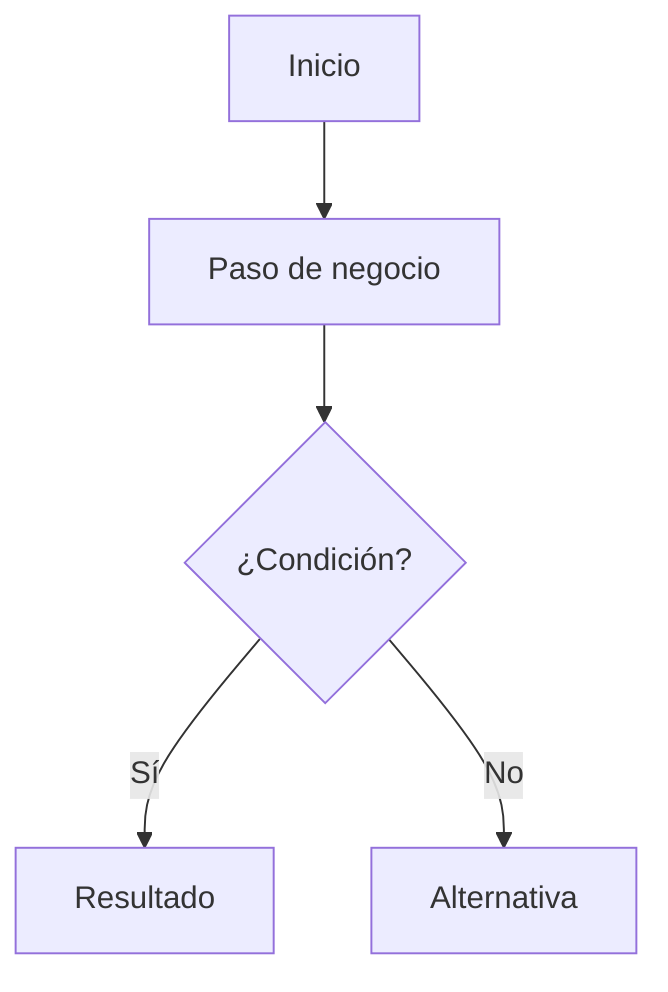

# Plantilla de flujo de negocio

> **Clasificación:** CONDICIONAL

## Propósito

Describir comportamiento de negocio independiente de tecnología.

### FLOW-XXX-001 — <Título>

- Disparador:
- Actor:
- Precondiciones:
- Reglas de negocio:
- Resultado esperado:
- Flujos alternativos:
- Errores relevantes:

