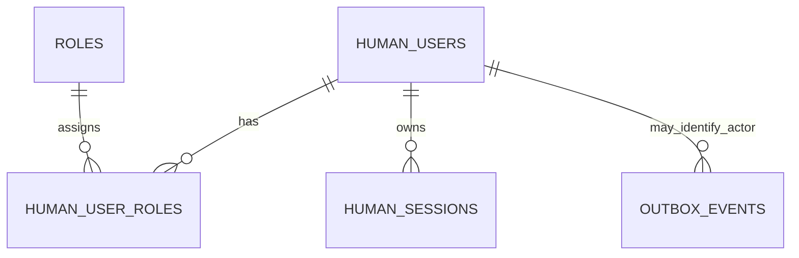

# Entity Relationship Diagram

> **Clasificación:** CONDICIONAL  
> **Estado:** Plantilla base  
> **Idioma de documentación:** Español  
> **Convención técnica:** Código, nombres de archivos, clases, variables, endpoints y artefactos técnicos en inglés.  
> **Fuente de verdad:** Este documento solo debe duplicar información cuando sea imprescindible; en caso contrario debe enlazar a la fuente canónica.

## Propósito

Mantener una vista lógica de entidades y relaciones cuando aplique.

## Identity implementado en OLA1-IAM-001a

Todas las tablas siguientes pertenecen exclusivamente al schema `identity`.

`LOGIN_ATTEMPTS` usa una clave SHA-256 no reversible y no conserva username o IP cruda. `OUTBOX_EVENTS` permite actor nulo exclusivamente para el caso aprobado en `AC-JAXON-060`. No existen FKs cross-module.
