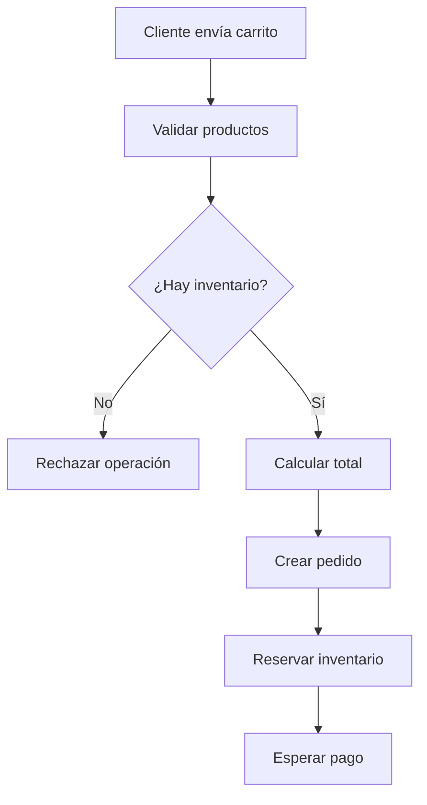

# FLOW-ORD-001 — Crear pedido

## Flujo de negocio

## Contratos relacionados

- contrato de entrada para creación de pedido;
- contrato con Inventario para reserva;
- contrato con Pagos cuando comience el procesamiento.

## Caminos alternativos/errores

- producto inválido → error de validación;
- inventario insuficiente → el pedido no se confirma;
- fallo de reserva → revertir o compensar según la decisión arquitectónica aprobada.

## Pruebas sugeridas

- unitarias para reglas de validación/cálculo;
- contrato con Inventario;
- integración para persistencia;
- E2E del journey crítico de compra.
